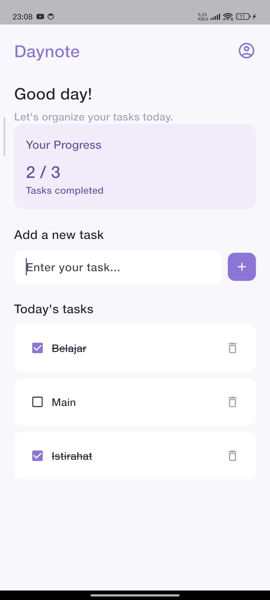

# Daynote - Your Personal Productivity Space

Aplikasi *Mini Task Tracker* sederhana berbasis Flutter untuk membantu pengguna mencatat dan mengelola aktivitas sehari-hari.

## Identitas

- **Nama:** Ridwan Faiz Herlambang
- **NIM:** 103012400061

## Screenshot



## Cara Menjalankan

Pastikan Flutter SDK sudah terinstal.

1. Clone repository:

   ```bash
   git clone https://github.com/paiszz/Study-Case-Motion-Lab.git
   ```

2. Masuk ke direktori project:

   ```bash
   cd Study-Case-Motion-Lab
   ```

3. Instal dependencies:

   ```bash
   flutter pub get
   ```

4. Jalankan aplikasi:

   ```bash
   flutter run
   ```
   
### Deklarasi Penggunaan AI

- **Apakah menggunakan AI?** Ya

- **Tool AI yang digunakan:** ChatGPT

- **Estimasi persentase kontribusi AI:** 30%

- **Bagian kode/fitur yang dibantu AI:**
  - Penjelasan konsep dasar Flutter dan Dart.
  - Referensi penggunaan komponen Flutter.
  - Bantuan debugging dan identifikasi error.
  - Panduan implementasi beberapa komponen dan pengelolaan state.

- **Pernyataan:**

  "Saya menyatakan bahwa saya memahami alur dan fungsi dari seluruh kode yang ada dalam repositori ini."